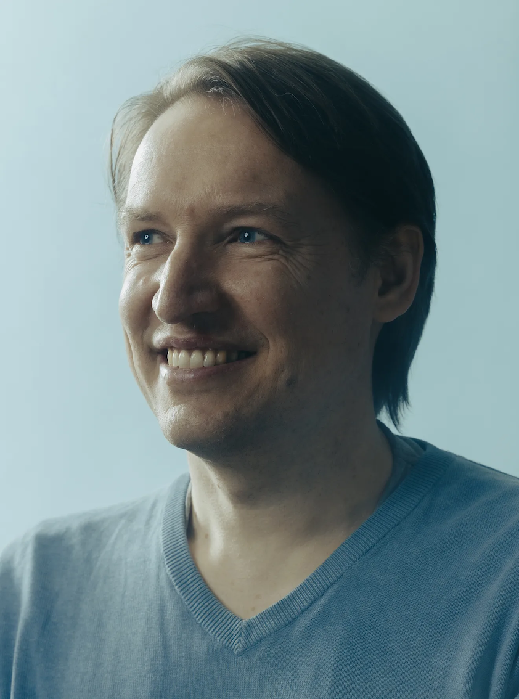
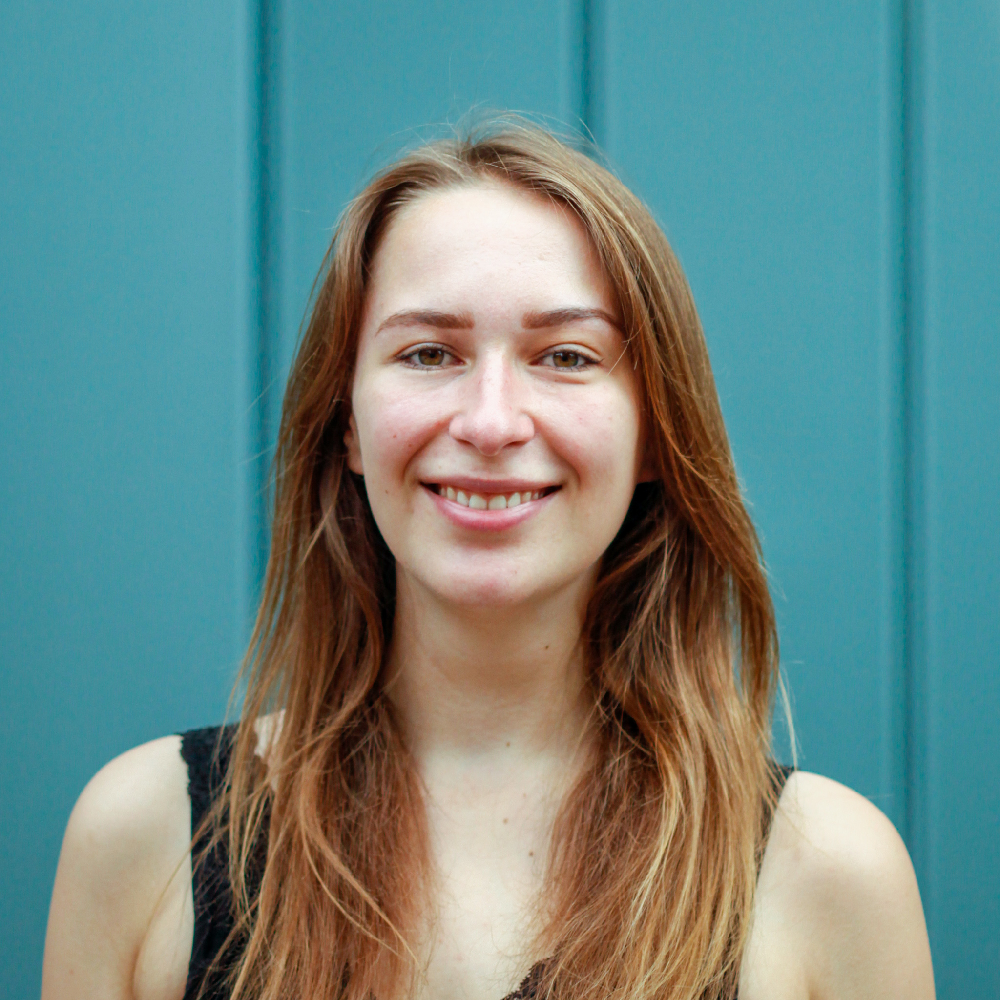
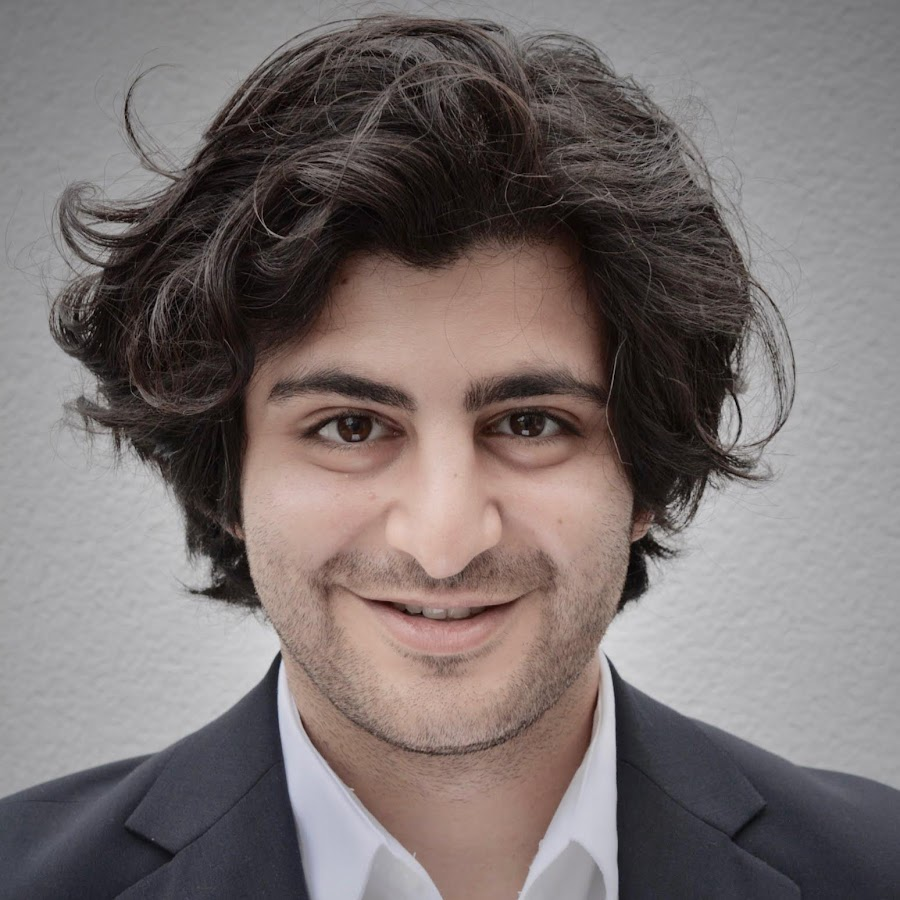
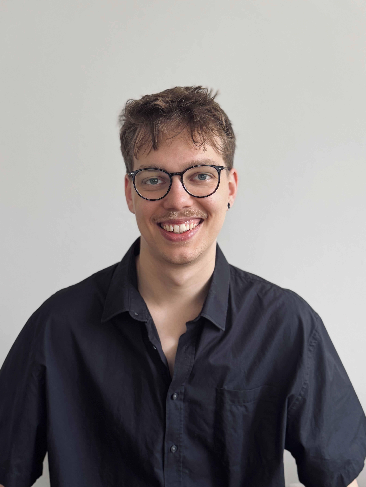

### **Daniel J. Schad**, Principal investigator

  

  
Daniel Schad is full professor of Quantitative Methods at [HMU Health and Medical University Potsdam](https://www.health-and-medical-university.de). He graduated from Potsdam University (Germany) and worked as a postdoc at the Charité in Berlin (Germany; in collaboration with ETH / University Zürich, Switzerland) and at the University of Potsdam. He was assistant professor (tenure track) for Cognitive Science and Artificial Intelligence at Tilburg University in Tilburg (Netherlands) before he started his lab in Potsdam in October 2020.

E-mail: danieljschad@gmail.com
  
  

  

{#id .class width=80% height=80%}

  

### **Laura Wirth**, PhD student

  

  
Laura received her Master in Psychology from the Humboldt University zu Berlin (Germany) and a Bachelor in Psychology from the University of Göttingen (Germany). She joined the lab in December 2022 and works on computational mechanisms in Pavlovian conditioning (Pavlovian-instrumental transfer and sign- versus goal-tracking) as well as on statistical methods.

E-mail: l.a.wirth@hotmail.de

  

  

{#id .class width=80% height=80%}

  

### **Nassim Sadedin**, PhD student (fast-track)

  

  
Nassim holds a Bachelors of Science in Business Administration and in Psychology and has work experience in the industry (ex Daimler Sales, ex Airbus Digitalization). Nassim is pursuing a masters in Psychotherapy at Freie Universität Berlin (expected graduation fall 2026). In parallel he is pursuing a fast-track PhD in computational cognitive neuroscience. He has already worked on empirical studies investigating the influence of mind wandering and transcutaneous auricular vagus nerve stimulation (TaVNS) on computationally defined instrumental learning processes. Currently he is working on an integrative model of Pavlovian learning and gaze dynamics, that aims to investigate human sign- and goal-tracking.

E-mail: n.sadedin@gmail.com

  

  

{#id .class width=80% height=80%}

  

### **Romana Caposova**, PhD student

  

  
Romana holds an MSc in Psychology from the University of Greenwich and an MSc in Computational Cognitive Neuroscience from Goldsmiths, University of London. Her PhD research examines how reward expectations and experience influence attention, learning, and action control. Combining eye-tracking, behavioral experiments, and computational modeling, she studies how value-based predictions guide gaze and behavior during Pavlovian and instrumental learning. More broadly, she is interested in computational approaches to cognition, particularly how learned internal representations shape attention, decision-making, and adaptive behavior.

E-mail: caposovaromana@gmail.com

  

  

{#id .class width=80% height=80%}

  

### **Ole Hausendorf**, PhD student

  

  
Ole completed a Master’s degree in Neurocognitive Psychology at University of Oldenburg and a Bachelor’s degree in Psychology at Hochschule Fresenius. His research interests include neuroimaging and computational modelling. He has experience in auditory M/EEG analysis and in structural and functional MRI analysis in Parkinson’s disease patients. In the lab, he investigates language processing using EEG and large language models.

E-mail: ole.hausendorf@hmu-potsdam.de

  

  

{#id .class width=80% height=80%}

  

